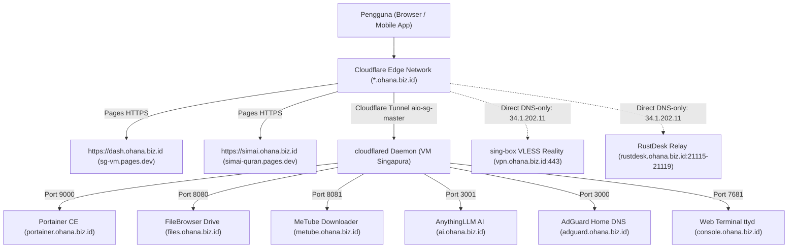

# Dokumen Serah Terima (Handover Document)
## All-in-One Cloud Server & Cloudflare Architecture

Dokumen ini disusun sebagai panduan lengkap bagi AI Assistant / Developer di sesi selanjutnya agar dapat langsung memahami seluruh topologi, kredensial, konfigurasi jaringan, repositori, dan prosedur operasional sistem tanpa kehilangan konteks.

---

## 1. Ringkasan Eksekutif & Identitas Infrastruktur

| Komponen | Nilai / Konfigurasi | Keterangan |
| :--- | :--- | :--- |
| **GCP Project ID** | `proxy-mesh-202611` | Google Cloud Platform |
| **GCP Instance** | `vm-singapore-master` | Zone: `asia-southeast1-b` (Ubuntu 24.04 LTS) |
| **IP Statis Permanen VM** | `34.1.202.11` | IP Publik VM Singapura |
| **Siklus Hidup VM** | 3 Bulan (Trial/Credit) | **Decoupled:** Tidak mengikat arsitektur domain |
| **Cloudflare Account** | `eardisis.dev@gmail.com` | `Account ID: 39f490a8a9cbdca3eca947a33db61b29` |
| **Domain Utama** | `ohana.biz.id` | Registrar: DomaiNesia (Zone ID: `303ece2a2c6754af1a6acdbb0e7018ef`) |
| **Cloudflare NameServers** | `everton.ns.cloudflare.com`<br>`sunny.ns.cloudflare.com` | Status Zone: **ACTIVE** |

---

## 2. Arsitektur Jaringan & Routing Subdomain

Seluruh domain dan subdomain dirancang **independen dari IP server** menggunakan Cloudflare Tunnel dan Cloudflare Pages, sehingga pergantian server di kemudian hari tidak memerlukan perubahan DNS.



### Tabel Rute Subdomain Lengkap

| Alamat URL | Jenis Rute | Target / Port | Fungsi Layanan |
| :--- | :--- | :--- | :--- |
| **`https://dash.ohana.biz.id`** | Cloudflare Pages | `sg-vm.pages.dev` | AIO Control Center & OpenBot AI Studio |
| **`https://simai.ohana.biz.id`** | Cloudflare Pages | `simai-quran.pages.dev` | Sima'i Qur'an PWA Web Application |
| **`https://portainer.ohana.biz.id`** | Cloudflare Tunnel | `http://127.0.0.1:9000` | Visual Container Docker Manager |
| **`https://files.ohana.biz.id`** | Cloudflare Tunnel | `http://127.0.0.1:8080` | Private Cloud Storage (FileBrowser) |
| **`https://metube.ohana.biz.id`** | Cloudflare Tunnel | `http://127.0.0.1:8081` | YouTube/TikTok Downloader 1 Gbps |
| **`https://ai.ohana.biz.id`** | Cloudflare Tunnel | `http://127.0.0.1:3001` | Private Document AI (AnythingLLM) |
| **`https://adguard.ohana.biz.id`** | Cloudflare Tunnel | `http://127.0.0.1:3000` | DNS Sinkhole & Privacy Ad-blocker |
| **`https://console.ohana.biz.id`** | Cloudflare Tunnel | `http://127.0.0.1:7681` | Web Shell Terminal (`ttyd` + WebSocket) |
| **`vpn.ohana.biz.id`** | DNS-Only (A) | `34.1.202.11:443` | sing-box VLESS + XTLS Vision Reality |
| **`rustdesk.ohana.biz.id`** | DNS-Only (A) | `34.1.202.11:21115-21119` | RustDesk Remote Desktop Relay |

---

## 3. Detail Cloudflare Tunnel (`aio-sg-master`)

* **Tunnel Name:** `aio-sg-master`
* **Tunnel ID:** `0476994b-a44f-4715-9185-b4aaef427bff`
* **Status:** `HEALTHY` (Aktif 6 koneksi edge simultan ke Singapura)
* **Token Layanan:**
  ```text
  eyJhIjoiMzlmNDkwYThhOWNiZGNhM2VjYTk0N2EzM2RiNjFiMjkiLCJ0IjoiMDQ3Njk5NGItYTQ0Zi00NzE1LTkxODUtYjRhYWVmNDI3YmZmIiwicyI6InpjL1BrZjNKamtSTFRLTXJFVVZLYmt6QjUxdXFXNGphVHVaWk92QnhhR1RmN3BEZCtWRGxXa1E0U0p2cHlmQVp4dzdoSG1YSFArMmVlQUtERUFnOTh3PT0ifQ==
  ```

### Prosedur Migrasi saat VM 3 Bulan Expired:
Bila nanti VM diganti dengan server baru di penyedia mana pun (Oracle Always Free / VPS baru / Home Server):
1. Salin seluruh direktori `/opt/app-data/` ke server baru dan jalankan `docker compose up -d`.
2. Di server baru, cukup jalankan:
   ```bash
   sudo apt-get update && sudo apt-get install -y cloudflared
   sudo cloudflared service install eyJhIjoiMzlmNDkwYThhOWNiZGNhM2VjYTk0N2EzM2RiNjFiMjkiLCJ0IjoiMDQ3Njk5NGItYTQ0Zi00NzE1LTkxODUtYjRhYWVmNDI3YmZmIiwicyI6InpjL1BrZjNKamtSTFRLTXJFVVZLYmt6QjUxdXFXNGphVHVaWk92QnhhR1RmN3BEZCtWRGxXa1E0U0p2cHlmQVp4dzdoSG1YSFArMmVlQUtERUFnOTh3PT0ifQ==
   ```
3. **Hasil:** Seluruh subdomain `*.ohana.biz.id` seketika langsung aktif dan terhubung ke server baru tanpa menyentuh DNS Cloudflare.

---

## 4. Kredensial & Autentikasi Sistem

> [!IMPORTANT]
> Catatan kredensial standar berikut digunakan di seluruh lingkungan:

* **AIO Web Control Center (`dash.ohana.biz.id`):** `admin` / `admin123`
* **Web Terminal Console (`console.ohana.biz.id`):** `admin` / `admin123`
* **Remote Desktop GUI (xRDP Port 3389):** User: `eardisis` / Sandi: `admin123`
* **FileBrowser Storage (`files.ohana.biz.id`):** `admin` / `admin`
* **Google Gemini API Key:** Tersimpan di `/opt/app-data/openbot/config.json` dan `/etc/environment` (variabel `GEMINI_API_KEY`)
* **Path Kunci SSH VM (Host Lokal):**
  `C:\Users\eardisis\.ssh\google_compute_engine`
* **Path gcloud CLI (Host Lokal):**
  `C:\Users\eardisis\AppData\Local\Google\Cloud SDK\google-cloud-sdk\bin\gcloud.cmd`

---

## 5. Konfigurasi Agen OpenBot & Gemini AI

1. **Model Aktif:** `gemini-flash-lite-latest` (dan `gemini-3.8-flash`).
2. **Karakter / Persona:** Disetel khusus untuk **percakapan santai/ringan (casual chat)**, hangat, ramah, berbahasa Indonesia alami dan luwes.
3. **Izin Sistem Tingkat Lanjut (Root & Docker):**
   * User `openbot` telah tergabung dalam grup `docker`.
   * Konfigurasi `/etc/sudoers.d/openbot` aktif dengan izin:
     ```text
     openbot ALL=(ALL) NOPASSWD: ALL
     ```
   * Agen dapat langsung mengelola kontainer Docker, service systemd, dan membaca log server non-interaktif tanpa meminta kata sandi terminal.
4. **OpenBot Hosted Server:** Berjalan sebagai systemd service `openbot.service` dan terhubung P2P WebRTC ke akun `eardisis.dev@gmail.com`.

---

## 6. Repositori GitHub & Auto-Deploy

Seluruh repositori GitHub di bawah ini terhubung otomatis ke Cloudflare Pages (*setiap `git push origin main` otomatis memicu deploy live ~30 detik*):

| Repositori | URL GitHub | Path Lokal | Keterangan |
| :--- | :--- | :--- | :--- |
| **`aio-cloud-server`** | [mitrawashlaundry-code/aio-cloud-server](https://github.com/mitrawashlaundry-code/aio-cloud-server) | `...\scratch\aio-cloud-server` | Script, Nginx, Systemd, & Guide |
| **`sg-vm`** | [mitrawashlaundry-code/sg-vm](https://github.com/mitrawashlaundry-code/sg-vm) | `...\scratch\sg-vm` | Cloudflare Pages Gateway Dashboard |
| **`simai-quran`** | [mitrawashlaundry-code/simai-quran](https://github.com/mitrawashlaundry-code/simai-quran) | `...\scratch\simai-quran` | Web App Al-Qur'an PWA |

### Aturan Eksekusi Git di Terminal Windows:
* Eksekusi `git add` dan `git commit` di dalam direktori repo.
* Jalankan `git push origin main` secara mandiri untuk memicu build Cloudflare Pages.
